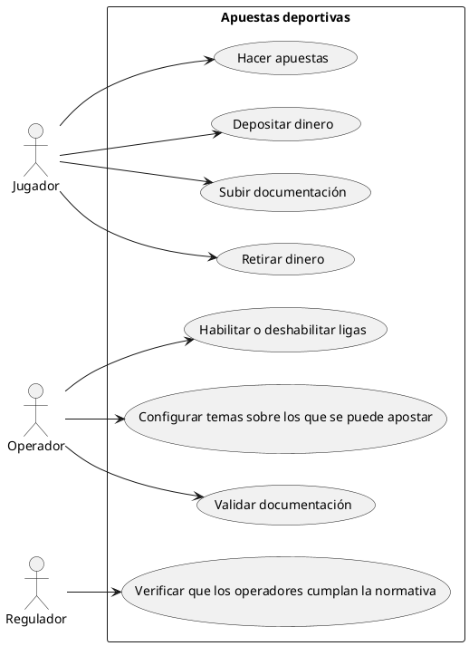

# Objetivos de hoy

- Definir un proyecto
- Ir adelantando algunos conceptos (Programación funcional, Devops, ...)

---

# TypeScript

## Tipado dinámico / Tipado estático

Todo lenguaje de programación maneja tipos de datos.
JS tenemos montonón de tipos de datos: string, number, boolean, object, array, null, undefined

> Variable: El cncepto de variable CAMBIA DE LENGUAJE EN LENGUAJE!

En C, Fortran, ADA, una variable es un CONTENEDOR. Es una zona de la memoria RAM donde deposito un DATO.
En JS, TS, PYTHON, JAVA una variable es otra cosa: ES UNA REFERENCIA A UN DATO que tengo guardado en RAM.
    Tiene más que ver con el concepto de PUNTERO en C.

Y el hecho es que hay lenguajes en los que no solo los DATOS tienen un TIPO DE DATOS. Hay lenguajes en los que las VARIABLES TIENEN TIPO DE DATOS.

```js
var texto = "hola";
//       ->
//       Lo que asigno es la variable al dato!
```

- "hola"    ->  Crea un objeto de tipo string en Memoria RAM co el valor: "hola"
                La memoria RAM la podemos ver como un cuaderno de cuadrícula.
                Básicamente hemos abierto el cuardeno por una página (npi) y hemos escrito el valor "hola" en una de las celdas.
- var texto ->  Crea una variable llamada "texto".
                Una variable, en JS es como un postit que pongo al lado de un dato en la memoria RAM. El el postit escribo "texto" no "hola".
- =             Asigna la variable al dato: PEGO EL POSTIT EN EL CUADERNO, al lado del DATO.

```js
texto = "adios"; 
```

- "adios"   ->  Crea un objeto de tipo string en Memoria RAM con el valor: "adios"
                Dónde? En el mismo sitio donde estaba el "hola" o en otro?
                Si fuera C, el valor "adios" sobrescribiría el valor "hola" en la misma ubicación de memoria.
                En JS/TS/JAVA/Python, el valor "adios" se guarda en otra ubicación de memoria y emn este punto hay 2 objetos/datos de tipo texto en RAM:
                - "hola"
                - "adios"
- texto =       Despego la variable de donde la tenía y la pego al lado del nuevo dato "adios".
                Reasigno la variable "texto" a un nuevo dato.
                El dato "hola" se queda huérfano de variable. Y en JS/TS/JAVA/PYTHON no hay forma de recuperar ya ese dato. En C si.. por la dirección de memoria. Se convierte en BASURA... hasta que potencialmente en algún momento (que no tiengo npi de si ocurrirá) el recolector de basura lo libere (Garbage Collector)

Tipado estático             Un lenguaje en el que las VARIABLES TIENEN tipo de dato.
                            En lenguajes de tipado estático, una variable solo puede apuntar a datos dl tipo (o un subtipo) del establecido para la variable.
                            Otra cosa, es que el lenguaje me permita crear una variable sin poner el tipo EXPLICITAMENTE, como pasa en TS. En ese caso, TS infiere el tipo de dato de la variable a partir del valor que le asigno inicialmente.
                            Pero la variable SIGUE TENIENDO TIPO DE DATO.
TS

Tipado dinámico             Un lenguaje en el que las VARIABLE NO TIENEN tipo de dato. OJO... 
                            No es que la variable INFIERA el tipo de dato (eso pasa en TS, o en JAVA). En JS es que NO TIENEN TIPO DE DATO. No es que el tipo de dato de la avriable cambie en tiempo de ejecución.
                            Lo que cambia es que la variable puede apuntar a datos de distinto tipo en distintos momentos de la ejecución del programa.
JS

TS -> Transpilación     Cuando traduzco de un lenguaje de un cierto nivel de abstracción a otro del mismo nivel.
                        .ts -> .js
      Compilación       Cuando traduzco de un lenguaje de un cierto nivel de abstracción a otro de un nivel inferior.
                        .java -> .class (byte-code)
                        .c    -> .o (código objeto)


> Cuál es el problema del tipado dinámico? 

Es que no tengo npì de como hablar con el código, por ejemplo con una función.

```js
function generarInforme(titulo, datos){}
```

Cómo hablo con la función?
- Qué le tengo que pasar? NPI
- Qué genera? NPI

Si el código es pequeño, tengo 4 funciones que hemos creado entre yto y mi primo no hay problema.
Si estamos en un proyecto grande con un equipo mediano, NO HAY FORMA.

Y surge TS para resolver esto.

De hecho, existe un lenguaje de programación llamado JavaScript? Lo que usamos hoy en día es JS? NO
Le seguimos llamando así por cariño. El lenguaje se llama ECMAScript. Y sigue una espeficicación de la ECMA (European Computer Manufacturers Association).

## Paradigmas soportados

Un nombre hortera que los desarrolladores ponemos a las formas en las que podemos usar un lenguaje para expresar una idea.
Los lenguajes naturales (los que hablamos los seres humanos) también podemos usarlos de varias formas:

- Imperativo                  Cuando el lenguaje me permite escribirórdenes que el computador debe ejecutar de manera secuencial.
                              Bueno.. a veces me interesa romper la secuencialidad.. y salen las típicas estructuras de control de flujo típicas de los lenguajes imperativo: Condicionales, Bucles, Tratamiento de errores.

                                JS , TS, PYTHON, JAVA, C# todos soportan paradigmas imperativos.

- Procedural                  Cuando el lenguaje me permite agrupar instrucciones bajo un nombre.. y luego invocarlas a través de ese nombre.
                              Esos grupos son lo que llamamos: funciones, procedimentos, métodos, subrutinas.

                                JS , TS, PYTHON, JAVA, C# todos soportan paradigmas procedurales.
                              
                              Qué aporta frete e la programación imperativa?
                              - Reutilizar código
                              - Facilitar mantenimiento del código (lectura...estructura)
                              - Por necesidad. Si tengo que llamar a una función que requiere una función como argumento, pues tengo que crear una función pasa poder pasarla como argumento. PAra estos casos, en programación funcional surgen las expresiones lambda: Funciones flecha

- Orientación a objetos       Todo lenguaje me trabaja con tipos de datos.
                              Y hay lenguajes que me permiten definir mis propios tipos de datos y cómo se comporta => Clases
                              Los datos de un tipo concreto -> Objetos / instancias

                                        Se caracteriza por                  Lo que uedo hacer/operaciones
                              string    secuencia de caracteres              upper, lower, length, substring
                              date      dia, mes, año                        caesEnBisiesto?

                              Y tengo el tipo de dato ComponenteWebParaRepresentarMiTablaDeDatos en JS? No

                              ComponenteWebParaRepresentarMiTablaDeDatos   datos, titulo...         renderizar() recargate()

                              Luego hay conceptos más avanzados: herencia (simple o múltiple), alternancia de tipos, polimorfismo, sobrecarga, sobrescritura

- Funcional                   Cuando el lenguaje me pemite que una variable apunte a una función, 
                              para posteriormente invocar la función desde la variable. 
                              El tema no es lo que es la programación funcional.. que es una chorrada.
                              El tema es lo que puedo llegar a hacer una vez que el lenguaje soporta esto:
                              - Crear funciones que aceptan funciones como argumentos: Inyectar lógica a las funciones en tiempo de ejecución
                              - Crear funciones que devuelven funciones (closures)

- Declarativo                 Cuando el lenguaje me permite expresar lo que quiero conseguir (estado final) sin especificar los pasos para llegar a él.
                                JS , TS, PYTHON, C#
                              Angular es purito paradigma declarativo: LAS ANOTACIONES/DECORADORES/ATRIBUTOS son paradigma declarativo
                               

> Felipe, pon una silla debajo de la ventana                                         IMPERATIVO
> Felipe, debajo de la ventana tiene que haber una silla. Es tu responsabilidad.     DECLARATIVO


---

# Backend vs Frontend

Cuál es la principal diferencia entre desarrollo Backend y Frontend?

La programación de frontales es por naturaleza ASINCRONA!
La programación de backend suele ser más síncrona.

Síncrona / Asíncrona?
- Síncrona: Cuando solicito la ejecución de una tarea, espero a que termine antes de continuar con la siguiente.
- Asíncrona: Cuando solicito la ejecución de una tarea, no espero a que termine y puedo continuar con otras tareas mientras tanto.

Formas de manejar la asincronía:
- Promesa (awaits)
- Callbacks
- Observables (RxJS) -> Callback... Programación reactiva = Modelo de programación
 
---

Hay muchos modelos de programación que se basan en programación funcional:
- Programación reactiva (RxJS)
- Programación Map/Reduce
- ...

---

# PROYECTO PARA EL CURSO: Apuertas deportivas

 BACKEND -> Frontal REACT
            Frontal ELECTRON

## Casos de Uso

De los casos de uso salen la arquitectura, requisitos (funcionales y no funcionales) y diseño del sistema.

Actores                         Casos de uso
    - Jugadores                     Hacer apuestas , Depositar dinero, Subir documentación, Retirar dinero
    - Operadores                    Habilitar o deshabilitar ligas, Configurar temas sobre los que puedo hacer apuestas, Validar documentación
    - Regulador                     Verificar que los operadores cumplan con la normativa

# UML

Es un lenguaje para escribir GRAFICOS, normalmente de diseño de un sistema.



# Qué objetos/modelos manejamos:

## Apuesta

- ID de la apuesta
- Jugador
- Cuota
- Monto
- Evento
- Fecha/hora
- Estado
- SeleccionId

## Jugador

- ID del jugador
- Nombre
- Email
- Fecha de nacimiento
- Documentación
- Listado de Apuestas
- Id Cuenta

## Eventos                  Madrid x barça

- ID del evento
- Nombre del evento
- Fecha/hora
- Tipo
- Estado

## Tipo                     Partido fútbol

- ID del tipo
- Nombre
- Descripción

## Mercado                  Quién gana? 
##                          Quién mete mas goles?

- Id
- Tipo Id
- Descripcion
- Id Evento 

## Seleccion                Quién gana entre Madrid-Barça?

- EventoId
- MercadoId
- Cuota
- Estado

Backend:
- App CSharp -> Postgres
  Servicios REST
            Websockets


# FRONTAL WEB / REACT

- Hacer apuestas
- Retiradas
- Ingresos
- Subir documentación
- Ver historial de apuestas
- Ver el tiempo real
- Recibir notificaciones de premios

---

# Arquitectura / Flujos de trabajo

Repositorios de git?
- 2 repos (Back y front)
- Decisión... acabaremos con 20-30 repos. 

BACK / Qué componentes tiene el back?
Cada componente necesitará su repo!
    Sin repo por componente no hay AGILE! por qué? 
        Necesito control de versiones de cada componente... para poder irlos liberando según estén acabados.

- Architectura multicapa propia
    - Modelos sobre los que trabajo y su lógica
    - Lógica de negocio / Servicios
       ^^^ NO VA A SER UN REPO DE GIT. Van a ser 2: API / Implementación
    - Persistencia / Repositorios (DAO)
      - Repositorio Postgres
      - Repositorio Mongo
       ^^^ NO VA A SER UN REPO DE GIT. Van a ser 2: API / Implementación
    - Exposición de los servicios/lógica de negocio
      - Controladores Rest      v2       ->          Esto generará un OpenAPI (antiguamente llamado swagger)
        - API
        - Implementación
      - Controladores Websocket

Otra cosa es que tenga luego un repo padre... y use SUBMODULOS de git para consolidarlos.


```csharp

interface IServicioApuestas<T>
{
    Apuesta Apostar(DatosDeNuevaApuesta apuesta);
    IEnumerable<Apuesta> ObtenerHistorial(T jugador);
    // Qué pasa si la bbdd está caída, que devuelve la función? DatabaseNotAvailableException!
}

interface IControladorRestApuestas
{

    //GetMapping("/historial")
        // Devuelve body response: JSON: Lista ApuestaDto
        // Aquí hay lógica de cómo expongo el servicio
        //       DatabaseNotAvailableException -> Http Status 500

    //PostMapping("/apostar")
        // Body RequestJSON: DatosDeNuevaApuestaDto
}

// Apuesta - mapeador -> ApuestaDto
// 
```

En frontal necesitaremos clases que representen los objetos JSON que devuelve el backend o que hay que pasar a backend...
Los vamos a generar en AUTOMATICO desde el swagger... No vamos a crearlos a mano, no? Esto lo hacéis?

Esto tiene que estar automatizado. No debe haber opción a no hacerlo. Es que se debe hacer solo!
Así no hay problema.

Luego meteremos el frontal de ELECTRON... y posiblemente necesite los mismos objetos JSON que el frontal web.

Y definiermos una librería para todo eso. Esa libreríaserá compartida.
Irá publicada a un registry de librerias NPM (nexus). Gitlab registry... igual que el nexus.


---
React           No tiene Contenedor de Inversión de control

Angular         
   Host         Contenedor de Inversión de control
 Spring         