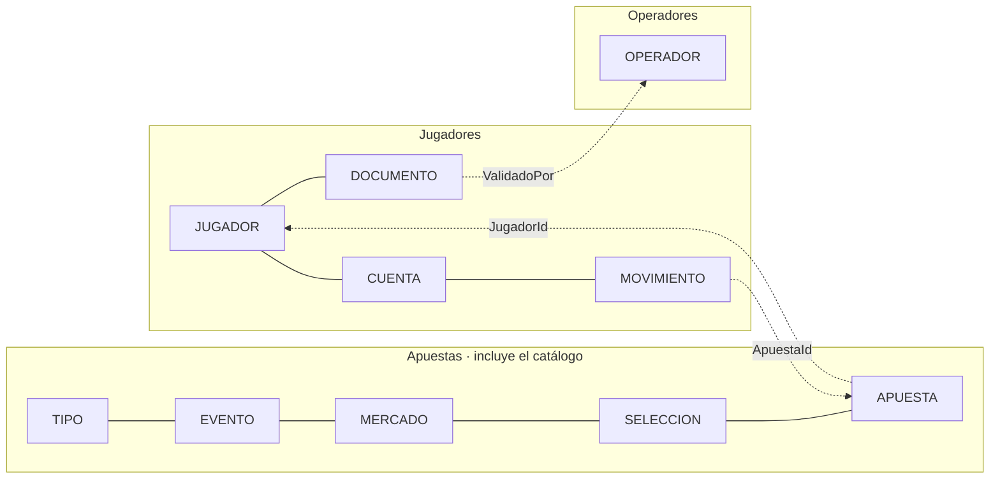
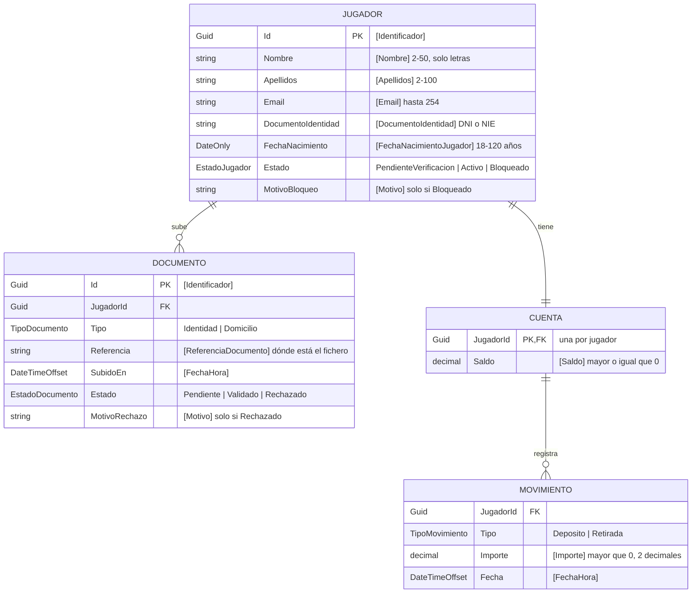
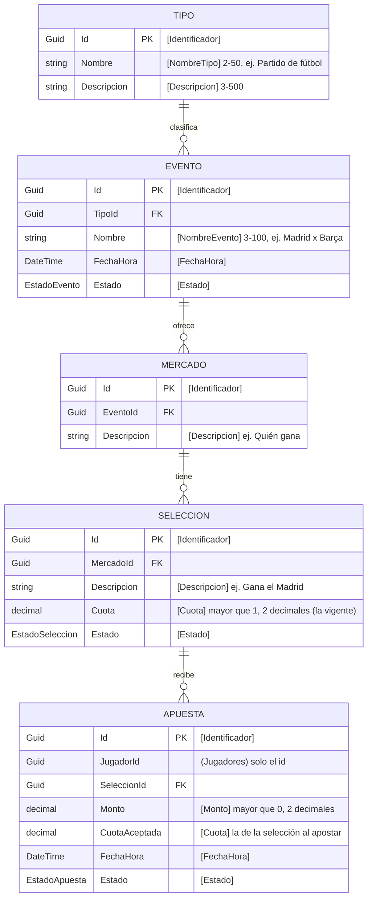
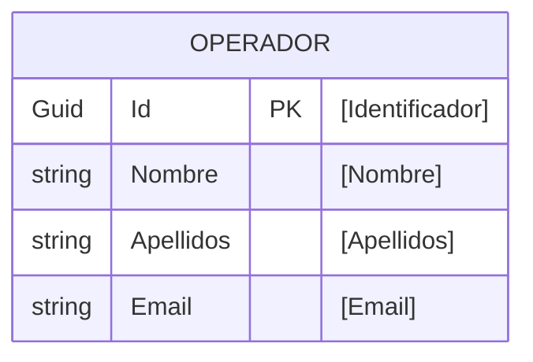

# Modelo entidad-relación

Los modelos del proyecto de apuestas deportivas, repartidos por microservicio. Cada
microservicio es **dueño de sus datos**: tiene su propia base de datos y nadie más escribe
en ella.

- **Dentro de un microservicio** las relaciones son normales: claves ajenas, integridad
  referencial.
- **Entre microservicios** solo hay **referencias por id** (un `Guid`), sin clave ajena. En
  los diagramas van en *cursiva* y con el microservicio dueño entre paréntesis. Para saber
  algo de la otra entidad hay que preguntarle a su microservicio.
- **Los ids que se ven son Guid.** La base de datos puede tener además ids numéricos
  internos, pero no salen de la capa de repositorio.
- Junto a cada campo va la **anotación** que lo valida (`[Nombre]`, `[Cuota]`…): de
  `Comun.Invariantes` o del `Invariantes` de su microservicio.

## Mapa general

Las flechas de puntos son referencias por id entre microservicios.

## Jugadores

Ya implementado en `Jugadores.Dominio`. `Jugador` es la raíz del agregado: los documentos
y la cuenta solo cambian a través de él.

**Reglas que el modelo no dibuja** (las impone el dominio):

- Un jugador solo pasa a `Activo` cuando se le valida un documento de `Identidad`.
- Solo un jugador `Activo` mueve dinero, y una retirada no puede dejar el saldo en
  negativo.
- Un documento validado o rechazado no vuelve a revisarse.
- Un movimiento no cambia nunca: la regulación exige poder auditarlos.

## Apuestas (incluye el catálogo)

El catálogo (tipos, eventos, mercados, selecciones) va **dentro** del microservicio de
apuestas: para aceptar una apuesta hay que comprobar, en la misma transacción, que la
selección sigue abierta y que la cuota es la vigente. Si un día el catálogo necesita
escalar por su cuenta, se separa.

**Por qué `CuotaAceptada` y no basta con la de la selección:** la cuota de una selección
cambia durante el evento. La apuesta guarda **la que el jugador aceptó**, que es con la que
se le paga.

**Respecto al modelo del día 1:**

- `Apuesta` tenía `EventoId` además de `SeleccionId`. Lo quito: el evento sale de la
  selección (selección → mercado → evento), y guardarlo dos veces permite que no coincidan.
- `Mercado` tenía `TipoId`. Tampoco lo pongo: el tipo es del evento. Si lo que quería decir
  es «qué mercados se ofrecen para cada tipo de evento» (en fútbol, «quién gana» y «cuántos
  goles»), eso es otra entidad, una plantilla de mercado por tipo, y hay que decidirlo.
- `Seleccion` no tenía id ni descripción. Sin id no se puede apostar a ella, y sin
  descripción no se sabe qué es («Gana el Madrid», «Empate»).

## Operadores

Todavía sin diseñar. Lo que se sabe por los casos de uso:

## Pendiente de decidir

| Qué | Dónde | Por qué importa |
|---|---|---|
| **Ligas o competiciones** | Apuestas (catálogo) | El operador «habilita o deshabilita ligas» (caso de uso del día 1), y en el modelo no hay ninguna entidad `Liga`. Iría entre `Tipo` y `Evento`. |
| **«Configurar temas sobre los que se puede apostar»** | Apuestas (catálogo) | Otro caso de uso del operador. ¿Es habilitar tipos de evento, mercados…? |
| **Cobrar la apuesta y pagar el premio** | Jugadores (cuenta) | Hacen falta movimientos `Apuesta` y `Premio`, con el `ApuestaId` como referencia. Lo pedirá apuestas a jugadores. Es una operación entre dos microservicios: si falla una mitad, hay que deshacer la otra (saga). |
| **Quién validó o rechazó un documento** | Jugadores | Para auditoría: guardar el `OperadorId` en el documento. |
| **Estados de evento, selección y apuesta** | Apuestas | Sus enumerados y transiciones (abierta, suspendida, cerrada, liquidada…), como se hizo con el jugador. |
| **Qué guarda el regulador** | ¿Nuevo microservicio? | El caso de uso «verificar que los operadores cumplen la normativa» necesita un registro de lo que hacen los operadores. |
